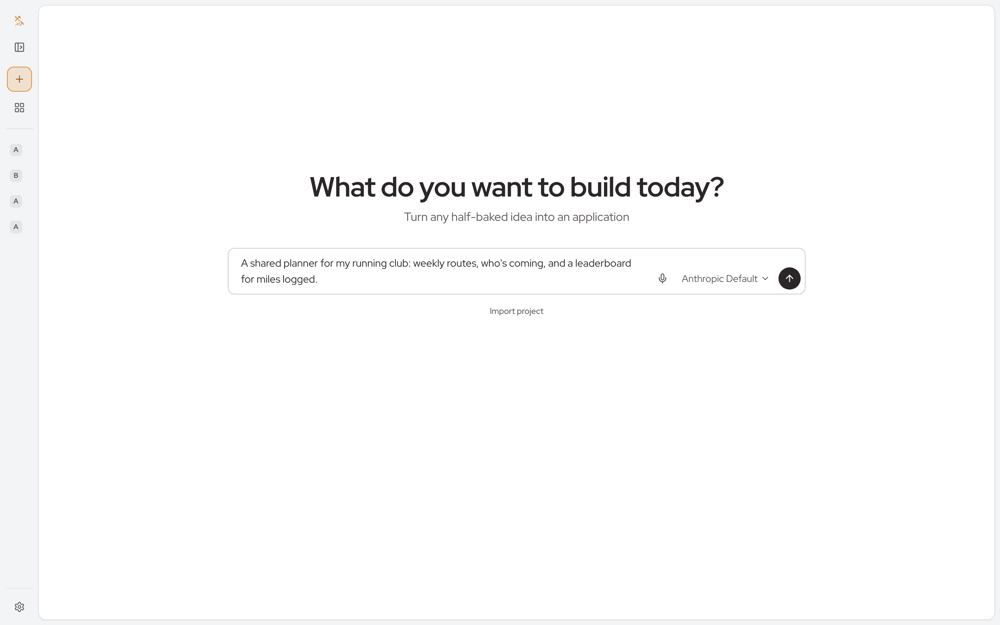

<p align="center">
  
</p>
<h1 align="center">Builder</h1>
<p align="center">Build, write, edit or improve anything by talking to one assistant, without being a developer.</p>
<p align="center">
  <a href="https://github.com/corbitsdev/corbits-builder/actions/workflows/ci.yml"></a>
</p>
<p align="center">
  <a href="https://github.com/corbitsdev/corbits-builder/blob/main/docs/USER_MANUAL.md">User manual</a> ·
  <a href="https://github.com/corbitsdev/corbits-builder/blob/main/docs/SELF_HOST.md">Self-hosting</a> ·
  <a href="https://github.com/corbitsdev/corbits-builder/blob/main/CONTRIBUTING.md">Contributing</a> ·
  <a href="https://github.com/corbitsdev/corbits-builder/blob/main/SECURITY.md">Security</a>
</p>



## How it works

1. **Say what you want.** Tell the coordinator what to build, write, edit or
   improve: an app, a command-line tool, a library, a document, research, an
   analysis, or a small change to something that exists. It asks what a
   careful colleague would.
2. **It brings in the help.** The coordinator composes specialists (a writer, a
   designer, a coder, a presenter, a worker, an analyst and any others
   installed) and ready-made plans to fit the work. There is no fixed path.
3. **Steer it.** Approve what needs your approval, answer questions on question
   cards, and ask for changes in plain words at any point, including while
   something is being built.
4. **Take it.** Download the code, the design and every document.

## Quick start

**With your coding agent.** In the folder where you want Builder, run
`npx skills add corbitsdev/corbits-builder`, then tell your agent:

```text
Set up Builder on this machine with the corbits-builder-install skill. Use Docker if I have it, otherwise my own Postgres. Tell me when you need me to do something.
```

**With Docker.**

```sh
mkdir builder && cd builder
base=https://raw.githubusercontent.com/corbitsdev/corbits-builder/main
curl -fsSLO "$base/deploy/compose.yml"
curl -fsSL "$base/.env.hub.example" -o .env.hub   # fill in each line marked Secret
docker compose --env-file .env.hub -f compose.yml up -d
```

Open http://localhost:8000. Ports, logs and running on a server are in
[SELF_HOST.md](https://github.com/corbitsdev/corbits-builder/blob/main/docs/SELF_HOST.md).

**From source**, with [Bun](https://bun.sh) 1.4.4 and Postgres 17: see
[CONTRIBUTING.md](https://github.com/corbitsdev/corbits-builder/blob/main/CONTRIBUTING.md#setup).

Then create an account and connect a model provider: log in with a ChatGPT or
xAI subscription, or add an Anthropic, OpenAI, Google Gemini or xAI API key in
the app or in `.env.hub`
([models](https://github.com/corbitsdev/corbits-builder/blob/main/docs/SELF_HOST.md#models)).

## Docs

- [User manual](https://github.com/corbitsdev/corbits-builder/blob/main/docs/USER_MANUAL.md): using Builder.
- [Self-hosting](https://github.com/corbitsdev/corbits-builder/blob/main/docs/SELF_HOST.md): running it with Docker.
- [Development](https://github.com/corbitsdev/corbits-builder/blob/main/docs/DEV.md) and [Contributing](https://github.com/corbitsdev/corbits-builder/blob/main/CONTRIBUTING.md): working on the code.
- [AGENTS.md](https://github.com/corbitsdev/corbits-builder/blob/main/AGENTS.md): conventions for coding agents.
- [skills/](https://github.com/corbitsdev/corbits-builder/tree/main/skills): agent skills to install Builder, drive it through its API and import a repository as a project.

Builder runs on [Interchange](https://github.com/faremeter/interchange), which
runs the agents and handles their messages, approvals and credentials.

## License

GPLv2 with the [AI Exception](https://github.com/corbitsdev/corbits-builder/blob/main/GPLv2-AI-Exception.md)
([LICENSE.md](https://github.com/corbitsdev/corbits-builder/blob/main/LICENSE.md)).
Contributions require the [CLA](https://github.com/corbitsdev/corbits-builder/blob/main/CLA.md).
