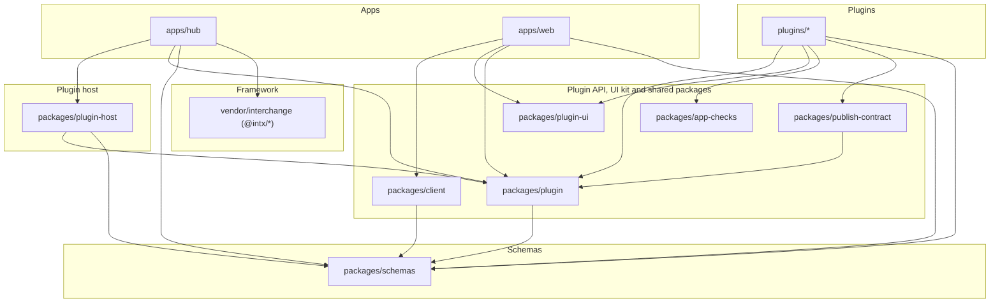

# Builder: architecture

How Builder is structured and why. What it does for a person is in
[PRODUCT.md](https://github.com/corbitsdev/corbits-builder/blob/main/docs/PRODUCT.md);
the concrete technology and layout are in
[IMPLEMENTATION.md](https://github.com/corbitsdev/corbits-builder/blob/main/docs/IMPLEMENTATION.md).

## Overview

Builder is a control plane (the hub) on top of an agent runtime (Interchange).
The runtime owns agents, workflows, mail between them, approvals, credentials,
sandboxed workers and run lifecycles. The hub adds what is specific to
Builder: projects, versioned documents, the plugins that say what work can be
done, the plan each project follows, the app repository and live preview,
preferences, and an API for the interface.

```
person -> interface -> client API -> hub -> runtime (workflows, mail, approvals)
                          ^           |  |        |
                          |           |  |        +-> sidecars running the agents
           plugin screens +           |  |
                                      |  +-> plugins/ (specialists, plans, skill packs)
                                      +-> documents, plan, values, app repository, live app
```

A person talks to one agent, the coordinator. Everything the coordinator can
have done is a plugin in the `plugins/` folder. The coordinator decides which
plugin action serves what the person asked and what instruction it gets; the
hub carries that decision out. It checks the call, starts the specialist, holds
the call open on a screen the person answers, runs the checks, and holds a step
of the plan until what it waits for is true. The coordinator never does those
by hand, so they happen the same way whichever model runs it.

## Layers and what may import what



An arrow means "may import". Code imports only from its own layer's arrows and
never the other way, so nothing points back up. That is why a plugin can be
added, renamed or removed without touching the hub, the web app or any other
plugin, and why imports cannot form a cycle. `bun run boundaries`
(dependency-cruiser) checks the plugin, host and package rules and rejects
run-time circular imports on every pull request.

Not allowed:

- A plugin importing the hub, the web app, the plugin host or another plugin.
- Anything other than the hub importing the plugin host.
- A package importing an app or a plugin.

## The hub

The hub is the server and the system of record. It:

- signs people in and holds tenancy: an install has workspaces, and each
  project is a tenant of its own under its workspace, holding the project's
  principals, documents, approvals and runs;
- creates projects and starts each project's coordinator;
- loads the plugins folder once at start, and refuses to start if any
  manifest or action folder is wrong;
- stores documents and their versions, the project's values and plan, and the
  records of its checks and runs;
- provides the tools agents call;
- hosts each project's app repository and runs its live preview;
- answers the interface's API and streams run progress to it.

It embeds the runtime's control plane in the same process and composes it
directly.

## How a request becomes work

### The coordinator's tools

The coordinator has a small fixed set of tools, and the set does not grow when
a plugin is added. A new capability is found by searching, not by a new tool,
so the coordinator's prompt stays the same size however many plugins are
installed.

- `discover` finds what can be done. With a query, in the person's words, it
  lists the plugins that match, each action on a line saying whether it can
  start now or what it needs first, then the project's values with what each
  holds now and a line on the plan. With a group it lists that group. With a
  plugin, or a plugin and an action, it gives that action's full guidance and
  the input it takes.
- `execute` acts. It starts a specialist's action, runs a check, or opens a
  screen for the person, by the plugin's handle and the action's name.
- `plan` keeps the project's plan. It is the only way a plan is set.
- `runs` lists the runs the coordinator started or stops one.
- `question` asks the person something in words: up to a handful of questions,
  each with options, and their answers come back as the call's result. It is
  Interchange's question tool, offered with Builder's wording. A choice that a
  plugin has a screen for is opened with `execute`, never asked this way.
- `read_artifact` lists and reads the project's documents; the coordinator
  files none itself. `read_file` reads back a tool result that was cut short.

With `PLUGIN_HINT` set to `triggers` or `fields` (it is `off` unless set), the
hub also reads each message the person sends and, when its words match a
screen's `when`, appends a short note naming that screen and how to open it.
The note is marked as Builder's and stripped from what the person sees. It
exists because a model left to itself will often invent its own list of fonts
rather than look for the font picker.

### Plugins

A plugin is a folder under `plugins/` whose `package.json` has a `builder`
block. The hub and the interface find plugins by reading that folder, so adding
one registers nothing anywhere else, and the host's code names no plugin. A
plugin builds only on the plugin API (`@corbits-builder/plugin`), the plugin UI
kit (`@corbits-builder/plugin-ui`), the shared schemas and shared packages such
as `@corbits-builder/app-checks`. The hub loads, searches, checks and starts plugins through
`@corbits-builder/plugin-host`, which no plugin imports.

A plugin is one of three kinds, by its `runs`:

- A specialist (`runs: "specialist"`) is work the coordinator composes into a
  plan, such as the writer, the designer or the coder. It declares its
  actions, and may declare the roles its runs play, the model settings and
  output budgets those roles name, the workflow packages and starters it
  brings, agents the host builds from a prompt alone, starters a first build
  can begin from (`appStarters`), a design workspace with its themes and looks
  (`design`), the facts its work is about in plain words, and project values.
- A ready-made plan (`runs: "plan"`) names actions of other plugins in order,
  with guidance for the coordinator and, for each step, whether the person may
  decline it and which approval it waits for. It has no agent.
- A skill pack (`runs: "skills"`) is guidance a specialist reads, such as how
  to lay out a Rust project. It names the specialist it `extends`, or another
  pack it narrows, so a framework's pack can sit inside a web app pack. The
  coordinator never sees packs.

Every plugin has a `handle`, the short name the coordinator uses, with
`groups`, `when` and `unless`, and optionally `examples` of how a person would
ask for it. Several installed plugins may share a handle, as the two
`build-web-app` plans do; a project uses the one its `plugins.<handle>` value
selects, else the one marked `default`. Exactly one must be.

### Actions

An action is a folder, `src/<action>/`, holding a `definition.ts` whose default
export says what goes in and how the coordinator fills it: its summary, when to
use it and when not, and each input field in words. The manifest entry under
`actions` holds only what the folder cannot say. The kind is read from the
folder, not written down:

- With a `view.tsx`, the action is a screen, shown to the person. Its
  definition is a `defineScreen`, which may also validate and prepare the
  input, say which project values the answer saves (`writes`), which
  preferences it sets (`prefers`) and what it approves (`approves`). A
  `data.json` beside it is data the screen ships.
- With ready-made proofs (`all` or `any`) in the manifest, or a `defineCheck`
  definition, the action is a check.
- Otherwise it starts work: a `defineWorkflow` definition, and a manifest entry
  naming the workflow it starts (or the agent the plugin declares), the facts
  it `requires` and `returns`, the values it `reads` and `writes`, the screens
  that can show what it made (`presents`), and the checks it must pass before
  it counts as finished (`done`).

An action's guidance and its refusals are written from the same field
descriptions, so what the coordinator is told before a call and what it is told
after a wrong one cannot disagree.

### What execute does

`execute` checks a call in a fixed order and stops at the first thing wrong.
Every refusal starts nothing, says why in words the model can act on, and says
what to do next.

1. The call's own fields. A wrong one is named, with everything `execute`
   takes.
2. The plugin. One that is not installed is refused with every action
   `execute` can start. A ready-made plan is refused with the `plan` call that
   takes it up.
3. The action. One the plugin does not have is refused with the plugin's
   actions and what each is for.
4. A screen goes no further here: the call is held open on it, as the next
   section describes.
5. The input, against the action's schema. The refusal names every wrong field
   at once, each with its problem and its choices or the rule it must meet,
   lists the fields that were fine, and asks for the same call with those
   fields corrected. Naming every field at once means the model is never
   refused again for the next one.
6. The plan. A step the person declined, or asked to be consulted on and has
   not given the go-ahead, is refused and the coordinator is told to carry on
   with the rest of the plan.
7. What the action needs. Its own `requires` lists alternatives, each a set of
   facts that together let it start, and a fact may be negated (`!app_exists`)
   or name an input field (`filed:{kind}`). The plan step it would do may also
   be waiting for the person's approval. When something is missing the refusal
   names each fact in plain words and which installed actions make it true.

Then a check runs and returns its record, and a workflow action is handed to
its starter. The starter writes the run's assignment from the project as it
stands, and the hub adds the values the action reads and the ones its run may
save. A starter can refuse too, in its own words: one coder works on a
project's code at a time, because the project has one app repository, and a
designer refuses a concept with no theme, or a call with nothing saying what
to design. `execute` returns at once with the run ids, the screens that can
present the result and any advice from the plan; the run's report arrives later
as a message that begins with its run id.

The run is recorded against the action and, when `execute` could tell, the plan
step it does. That record is what lists the run among the coordinator's, lets
the coordinator stop it, ties it to its step on the plan, and limits which
project values it may save.

### Screens

A screen holds the coordinator's call open until the person answers, with no
time limit, and the person's answer is the call's result. This rests on a hook
Builder adds to its vendored Interchange: a tool may check a call before it
runs and park it on Interchange's question wait instead. The question waits in
the run log, so the screen survives a reload and a hub restart.

When `execute` names a screen, the hub reads the values the screen declares,
validates the input against the screen's schema and its own `validate`, and
checks what the screen `requires`. If anything is wrong, the call is refused
before anything is shown. Otherwise the interface reads the open question from
the run log, finds the plugin's view by package and action, and draws it in the
conversation or, for a screen placed on the page, over the whole room with the
prompt box still in reach. A view receives everything as props and never
touches the run or the network itself.

Every answer lands on one hub route, `POST .../projects/:projectId/answers`.
The hub first claims the question, so a second answer is refused before it
saves anything. It checks a screen's output against the screen's schema, saves
the project values the screen writes where they changed, records what the
answer approves for the exact version that was shown, and sets the preferences
the screen sets, such as handing approvals to Builder. Then it delivers the
answer to the run through Interchange's signal route as the person. A run's own
token cannot call this route, so an agent can never answer for the person.

Whatever is on screen, the person can type a sentence instead. That closes the
screen and the call returns `{ reply }` with their words.

A screen whose answer is "accept this, or send it back with feedback" declares
that once, as its definition's `decision`, and the interface draws every
control that answers it. With nothing pending and nothing typed, accept is the
action; otherwise the prompt box's own Send sends the feedback, with the count
beside it, and accepting becomes "… anyway" behind a confirmation that names
what it would discard. The designer's mockup review sends a typed note and its
pinned comments back as one output; the writer's document approval takes what
the person types as their answer in their own words.

`execute` also opens a screen on its own in one case. When the only thing
holding a workflow action back is its plan step's wait for the person's
approval, and exactly one installed screen gives that approval, `execute` shows
that screen and starts the action once the person answers. If they write back
instead, nothing starts.

### Facts and values

A fact is something true of the project that Builder works out from what it
stores; nothing records a fact directly. The hub's own facts are each planning
document filed (`filed:product_requirements`), each approved
(`approved:build_plan`), a design option filed, the design chosen at its
current version (`design_chosen`), and the project having code (`app_exists`).
A check adds the facts it `returns` while its latest record is a pass or the
person's skip and nothing it read has changed since. When the person leaves
approvals to Builder, every filed planning document counts as approved. A
plugin describes the facts its work is about in plain words, and those words
are what refusals and `discover` say.

A project value is a named piece of project data that a plugin declares, such
as `brand.guidelines` or `look.font-primary`, with what it holds in a line and
its type: text (optionally with a pattern), JSON, a link or an attached file.
A value is declared once, so its words and type never disagree, and any action
may read it. The hub supplies the values an action reads: a screen gets them as
props, and a run gets them as a labelled block in its assignment, so the
coordinator never has to find or pass what the project already stores. A person
saves a value by answering a screen, or by pressing a button on a screen a plugin
shows on its own, which runs one of that plugin's tasks: the Publish tab clears
`publish.keep` and `publish.holding`, and with them a `publish.release` the
person says is gone. A run saves only the values its action
lists under `writes`, with `report_values`, and the hub checks the name and the
type. A value that names a style token, as the designer's fonts and colours do,
lives in the filed design's `styles.css` once there is a design, and in the
project's own store before that.

### The plan

The plan is a list of steps saved on the project, each a plugin action with its
input, and each optionally inside a group. The coordinator writes it with
`plan`: from a ready-made plan, which `add` copies on as one group and which the
project then follows; from steps it writes itself, which is the normal case for
anything that is not a web app; or both. The plan is what the person follows
along with, and it is still there after a long conversation is compacted or the
coordinator is replaced.

Each step carries its own gate: the approval it waits for (`approval`, naming
the documents or the design, and `when`) and the facts it suggests having
first (`requires`). A required approval waits for the person's own answer even
when they left approvals to Builder; an optional one waits only while they
decide approvals themselves. What else a step requires is advice: `execute`
starts the action anyway and its result says what the plan suggested and why.
An action's own requirements always hold. Nothing tracks a position in the
plan, so removing a step removes its gate.

Only the steps and the person's marks on them are stored: declined, asked to
be consulted first, given the go-ahead, answered, cancelled. Where each step
stands is worked out every time the plan is read, from the project's facts, its
checks' latest records, the coordinator's runs and the screens still open, so
the plan cannot say a step is done when the records say otherwise:

- cancelled or declined by the person, it is cancelled or skipped;
- a screen step the person answered is done, and an optional screen step is
  skipped once they leave decisions to Builder;
- a check step follows its latest record that is still current;
- a step whose run is at work is running, or needs the person while that run
  waits on an approval only they can give;
- a step whose run ended blocked is waiting for its cause to be dealt with,
  and one whose run ended without making what the step returns true has failed;
- a step whose own run completed and whose returned facts hold is done;
- a step set to ask first, with nothing else missing, needs the person;
- a step whose requirements or required approval do not hold is waiting, with
  each missing fact and what makes it true;
- anything else has not started.

A group takes its state from its steps. The person declines and restores
optional steps, sets "ask me first" and gives the go-ahead from the plan in the
interface; each goes to the hub, which tells the coordinator in a note.

### How a specialist's finish is checked

A specialist's reply is held until its work is actually done. A role that files
documents waits for a filed document; an action that lists `done` checks waits
for the hub to run them on the work as saved, the coder's `builds` check
running the commands the project's `stack.checks` value lists. A held reply is
answered in the same conversation with what is missing and the evidence of any
failed check, and the agent carries on. After three held replies the run ends
as not finished, with its last reply as the reason, and the coordinator hears
of it as a note. A reply after a Builder tool refused the agent's access is
never held.

A specialist that cannot go on can report that it is blocked, with its reason
and what it tried. Its next reply ends the run as blocked, and the
coordinator's note leads with the block. Three tool results in a row that fail
the same way get one note telling the agent to change course; six end the run
as blocked by Builder.

When a finished run's action `presents` screens, Builder's note after the
specialist's report names the screens that can show the work and when each
fits, so the coordinator opens the right one with the newest version filled in.

### Checks

A check proves one thing about the project as saved and records whether it
holds, with evidence. Builder ships ready-made proofs a plugin uses by name
with no code: a file exists, a file contains some text or a JSON key holds a
value, a document is filed or approved, a design is chosen, a value is set or
equals something, and commands pass against the saved app. They combine with
`all`, `any` and `not`, and a check can instead run its own code over a
read-only view of the project. A check reads only what the project stores and
contacts nothing outside it, so no check can say that an address answers. A
check runs once, keeps trying for a set time, or waits on the person, who can
fix what it names and run it again, or skip it unless the check says
`"skip": "never"`. A skip is recorded as theirs and never as a pass. Each
record names what the check read at the version it read, so a pass stops
counting as soon as any of it changes. The hub can also run a check again by
itself after a saved change; a plugin's manifest says when
([DEV.md](https://github.com/corbitsdev/corbits-builder/blob/main/docs/DEV.md#one-action)).

## Specialists and roles

A specialist's role is declared once, in its plugin's manifest under `roles`:
its label, the model setting and output budget it runs on, the hub tools its
agent gets, its one-run-at-a-time slot, its status wording, the preferences its
assignment carries, and what it does (writes code, drafts the design, files
documents). The hub and the interface read roles only from there and tell a
run's role by the `role` tag on its agent. The coordinator is the one role no
plugin declares; the hub declares it.

The specialists installed today:

- The writer (`plugins/writer`) writes one document per run: product
  requirements, a build plan, or any other kind the task names. Its second
  role, the reviewer, gives the coordinator a second opinion on a filed
  document as advice. Its `approve` screen puts filed documents in front of the
  person.
- The designer (`plugins/designer`) makes one clickable HTML and CSS mockup
  per design concept and pass, from one of five themes or a theme it creates.
  Its screens ask how many looks to compare, review a mockup, choose between
  concepts, and pick fonts and colours.
- The coder (`plugins/coder`) builds the project's code once, then makes each
  later change, whatever kind of thing the project is. A first build may start
  from a starter the plugin declares, a web app or a bare TypeScript project,
  or from an empty workspace in the stack the build plan names.
- The presenter (`plugins/presenter`) builds a slide deck and approval package
  for one audience.
- The worker (`plugins/worker`) does any task no other specialist fits:
  research on the web, a question about the project or its code, or a document
  that needs outside facts.
- The analyst (`plugins/analyst`) works out numbers and files them as a
  document.
- The project plugin (`plugins/project`) has two screens and no agent: one
  hands the person's approvals to Builder or takes them back, and one shows
  what they must set up outside Builder.
- The publish plugin (`plugins/publish`) has no agent. Its Publish tab shows
  where the app is published, and three screens ask in the conversation: where
  to publish when more than one place is installed, the person's go-ahead
  before each publish, and before the app is taken down. It declares the values every target shares (`publish.release`,
  `publish.plan`, `publish.keep`, `publish.holding`, `publish.take-down`).
- The Cloudflare plugin (`plugins/cloudflare`) publishes the app to Cloudflare
  Workers at its own workers.dev address, either in the person's own
  Cloudflare account through a token they save or in a temporary account: they
  accept Cloudflare's terms for it and have an hour to keep the app. Its checks say
  whether the app is made to run on Workers, whether the saved version is the
  one published, and whether the person agreed to take it down. Its `remove`
  action takes the app down with the person's own key; it cannot reach an app
  in a temporary account, and says so.

The ready-made plans installed today:

- `build-web-app` (`plugins/build-web-app`): requirements the person approves,
  a design they choose, a build plan, then the build. `plugins/build-web-app-express`
  shares its handle; it makes one design instead of offering to compare looks,
  and nothing in it waits on the person. The first is the default.
- `add-feature` (`plugins/add-feature`): revised requirements and a build plan
  the person approves, then the change to an existing app.
- `publish-to-cloudflare` (`plugins/cloudflare-publish`): checks the app is
  made to run on Cloudflare Workers, asks the person's go-ahead, publishes it
  to Cloudflare and checks the saved version is the one published. It takes
  the app down with `cloudflare remove`.

The skill packs installed today, each for the coder or a pack it narrows:
`web-app-skills`, narrowed by `react-router-skills` and `sveltekit-skills`;
`web-app-starter-skills` for the `web-app` starter; `rust-skills`;
`desktop-app-skills`; `chat-bot-skills`; and `publish-skills`, narrowed by
`serverless-skills`, itself narrowed by `workers-skills`.

Every specialist run is triggered by mail, takes exactly one assignment and
ends; only the coordinator keeps its agent and takes each later message as
another turn. A later design pass or code change is a fresh run that starts
from what the earlier one left. What lives with a run lives only as long as
it: a person's "always allow" for package installs covers one build or one
change, and the next asks again.

Only the coordinator talks to the person. Specialists put questions in their
reply to it, and it settles them with a stated assumption unless the answer
changes what gets built, in which case it asks.

## Publishing

Publishing puts the saved app where people can open it. Every target it publishes to
is a plugin in the `publish` group, so the host names none. When the person
presses Publish in the Publish tab, or asks in their own words, the coordinator
finds the ready-made plans in the group, opens `publish choose` when more than one is
installed, and follows the chosen plan: the target's `ready` check, `publish
confirm` for the go-ahead, then the target's `publish` action. That action
pauses on its key screen while a key its agent's tools use is missing
([DEV.md](https://github.com/corbitsdev/corbits-builder/blob/main/docs/DEV.md#the-folder-and-the-manifest)). The target's tools do the
work in fixed steps and record `publish.release`. Its `live` check turns that
record into the fact that ends the plan, `published:<target>`, which lapses when
a newer version is saved. The Publish tab works out its state from these
records alone.

`publish choose` lists each plan by its package's `description`: what the
person gets, what it costs and who bills. `publish confirm` shows, before the
app first goes out by a plan, the plan's `firstRun`: where it goes and the
one thing to know first, such as an address that is not secure (https) yet. For
changes it says only that the address people open will show the version saved
last. A publish that cannot update the release recorded, because it goes to
another target or one that cannot update it yet, shows `firstRun` and says
the app gets a new address while the earlier one keeps the earlier version.

The confirm saves the go-ahead as `publish.go-ahead`, `{ plan, at }`, dated by
the hub. The `publish agreed` check, which cannot be skipped, returns
`agreed:publish` from that answer until a release is recorded after it, `publish.plan` names another plan, or the take-down screen
clears it. An answer's saved values cannot read the saved app's version, so the
release recorded after the go-ahead is what says the publish it allowed went
out. Each
plan's guidance runs `publish agreed` before opening the confirm and carries on
under it through an attempt that fails, is blocked or needs another step
first. The check guides the coordinator and gates nothing: no target's `publish` action requires
`agreed:publish`, since a go-ahead that cannot name the version the person
agreed to is the coordinator's sign not to ask again, not a gate.

Taking the app down works the same way. The person presses Take it down in the
Publish tab, or asks in their own words, and the coordinator opens `publish
take-down` with the plan whose target `publish.holding` or `publish.release`
names. The screen shows, in the take-down action's own words (its definition's
`says.removes`), what goes and what becomes of what people entered, with the
address people open and, for something held, where it is and what it costs.
"Take it down" saves `publish.take-down` as `{ target, release?, holding? }`,
with the `at` of the release and the `since` of the holding the person was
shown, and clears `publish.go-ahead`, so a later publish asks again; "Keep it"
saves it as null, and so does the go-ahead to publish again on the confirm
screen, so a later take-down asks again. The coordinator then runs the target's
`removable` check and starts the plan's `takeDown` action, which the hub refuses until that
check's fact holds. The take-down's agent holds only tools that take the app
down and look, never one that publishes, and the publish agent holds none that
takes it down. A republish, or a take-down that cleared what the person was
shown, changes what the check read, so an old go-ahead never takes down a later
release; a take-down that failed can be tried again on the same one.

Cloudflare's account screen has a take-down mode. While the person's go-ahead
to take down stands for Cloudflare, it asks only for a token for the account
the app is in; for an app in a temporary account whose keep link is still
recorded, it also says when Cloudflare removes the app by itself, or that it
did. `cloudflare remove` pauses on that screen while no token is saved, unless
`cloudflare.terms` is set, so the screen usually comes first. When it runs
without a token it answers `needs_own_account`; an app Cloudflare already
removed is cleared by the person from the Publish tab.

A new target implements this contract:

- It lists `publish` in its groups, and its ready-made plan ends on
  `published:<target>`, using `publishedCheck` for its `live` check.
- Its own tool writes `publish.release` and, for an app the person must still
  keep, `publish.keep`, with `replaceable: false` on a release the next publish
  cannot update.
- Its tools are `fixedTools` that reach the hub through `runHub` and answer
  with fixed codes and a few typed fields, never the target's own output.
- Its account key is an http credential, which may declare `signIn` so the
  person signs in at the provider instead of pasting it. A machine key the hub
  makes for it is an ssh credential that says `provisioned: true` and has no
  form; the actions that make it list it in `provisions`.
- For as long as something it made costs money, such as a rented server, its
  own tool records `publish.holding` (`target`, `place`, `since`, and `costs`
  as the person reads it), and it clears that only once the provider confirms
  the thing is gone.
- Its plan declares `takeDown`, the workflow action that takes down what it
  published or holds. That action starts on no input (each field has a
  default), so nothing the coordinator writes widens what the person agreed
  to. Its definition's `says.removes` says what goes and whether what people
  entered is destroyed or kept, and the take-down screen shows that. The
  action runs its own agent, whose tools only take down and look, and it
  requires the fact of a check built with `removableCheck` (`"rerun": "value"`,
  `"skip": "never"`). That check passes only while `publish.take-down` names
  this target and each release and holding recorded now is the one the person
  was shown, so a go-ahead for an earlier release never takes down a later
  one, even while the machine it is on is still held. The person cannot skip
  the check: a skipped check's fact counts, and only their answer on the
  take-down screen may make this one true. `recordedFor`
  in `@corbits-builder/publish-contract` decides which release and holding a
  take-down covers, and `takeDownStands` whether the go-ahead still stands for
  them; the check, the screens, the target's own tools and the Publish tab all
  read them through those. Each target's take-down tool checks it again for
  itself through `takeDownAgreed` before it acts and answers `not_agreed`, so
  "Keep it" pressed after the coordinator started the removal is seen.

The Publish tab is the publish plugin's own screen, `publish published`, which
the room shows as a tab of the project view, with where publishing stands
beside the plan. The hub works out its state each time the room reads the
plan, from the project's records alone, never from what the page remembers or
an agent wrote. The rows that decide it are in the comment on `publishState`
in `plugins/publish/src/published/state.ts`, and the first row that matches
wins. Its buttons run the plugin's tasks. Publish, Publish changes, Carry on
publishing, Try again and Take it down run `publish ask`, which records the
press in `publish.asked`, dated by the hub, and tells the coordinator what the
person asked for. A go-ahead on `publish confirm` or `publish take-down` records
it too, and "Keep it" there withdraws it.

A publish or a take-down is a chain of hand-offs (a press, the coordinator's
turn, a screen, an answer, a check, a run, its report), and between links
nothing may be at work and nothing asked. So a press shows the work under way
until a publishing run starts after it or a turn of the coordinator ends after
it, and the project is busy while anything is at work on it, and for 20 seconds
after work last moved on: a run of any plugin on it ended, or the person asked.
That window and the keep link's deadline are the only rules read from the
clock, which is the hub's, and the screen says when the clock alone next
changes it, so the room reads it again then. Once the window passes with
nothing at work the tab reads what the records say.

The release is behind once the saved app is a newer version than the one it
records and no publishing run has started since it went out: a newer version
was saved, which is not a publish under way. A release recorded for its target
makes its `live` check pass, so the plan reaches its end with no step left to
the coordinator. A release to another target, or a take-down that clears it,
drops the fact with no failed step, since an app published elsewhere or taken
down on purpose has not failed. A check never run has read nothing, so the
coordinator still runs the first publish's `live` step. The check re-runs by
itself once it has a record
([DEV.md](https://github.com/corbitsdev/corbits-builder/blob/main/docs/DEV.md#one-action)).

While `publish.keep` is set, the way to keep the app shows over whichever state
applies. The keep link works like a password, so the room never saves a shown
screen's state in the browser. While `publish.holding` is set, every state
shows one more line, a fact beside the state's own rather than a notice:
"Hosted on DigitalOcean · $6 a month" under the address and its date once
published, or "Hosting on DigitalOcean since" its date before, with "billed
there" for a target that does not say its price. Its menu holds "I already
removed it from DigitalOcean…" for hosting the person removed themselves, which
asks a second time in the menu, then runs `publish gone`, which clears the
holding and any release its target recorded.

The tab offers a quiet "Take it down", apart from its main button, while a
release or a holding is recorded and a publish plan's `takeDown` names its
target (a holding's target wins over a release's). It is not offered while
work is under way, while a question is open, or after a failed take-down,
whose own "Try again" asks for the take-down again. Its menu holds "I already
removed it myself…" for an app the person removed where it went, such as by
cancelling the server, which no take-down can reach. It asks a second time in
the menu, then clears the release and the go-ahead to take down. Nor is it
offered while a keep link is recorded and nothing is held, since no take-down
can reach an app the person has not kept yet. The question it leads to is
where they decide.

The hub makes and saves the key for a person's server (below). A Cloudflare
token is saved to Interchange like any plugin key. A temporary Cloudflare account's
token lives in the tool's memory for the one release that made the account.
The keep link is `publish.keep`, a private value: only someone who manages the
project reads it, and no model does.

### Hub-made server keys

The hub makes every server key (`apps/hub/src/credentials/`), both for a
person connecting their own server and for a target that rents a server for
them, so no browser ever holds a private key. For each server it makes an
Ed25519 pair and an unguessable label and stores them in `sb_server_key`, one
row per project and credential name, with the private half sealed under the
credential cipher and the issuer recorded: `person`, or `plugin:<handle>` for
the plugin whose run asked. A live run of an action that provisions the credential may ask for the
public half and label, ask the hub to bind the key to a server by its public IP
address and the fingerprint of the host key it must present, and ask it to
revoke the key its plugin made. The hub binds only after it has signed in with
the key to that address, pinned to that host key. It then saves the key as the
plugin's `ssh` credential in the project, the same rows a person's form would
save, and drops its own copy of the private half, so the credential is the only
place the key lives. A run never gets the private half. It never binds to a
host name or, outside development, to a private address or a port other than
22, and never replaces or revokes a key that a person or another plugin made.

A person connects their own server through the same module, on their session
and only with the grants to save a provider and a credential in the project.
They get a key, the same one until it is connected or they ask for a new one,
and name the server by the address or host name their provider shows. The hub
takes the host key the server presents on first contact, since the person typed
the address, and proves the key signs in before it saves anything, so a key
the person has not yet added at their provider is refused in words that say
so. Their key replaces whatever key the project held under that name; the
earlier one stays saved and working until the new one connects. The form opens
on a read that never makes a key: the connected server and its key's public
half, or else the key waiting to be connected. While a new key waits and the
old server stays connected, the connected server and its public half are read
from the credential, since the new key's row says nothing of it. A `provisioned` credential is never a
person's, so their routes answer `server_key_unknown` for its name. A key
revoked in Settings leaves its row behind as lost, and the person's next request
for a key replaces it.

A rented server first presents a host key that the run made and handed to the
provider in the server's user-data, where it stays readable on the machine.
Pinning to it keeps out a server that is not the one rented, but not someone
who can read the machine and stands on the network path to it. The hub does not
rotate the host key after binding, because a failure between restarting the
server's SSH and saving the new fingerprint would lock Builder out of a server
the person pays for.

### Signing in at a provider

A target whose account key declares `signIn` lets the person sign in at the
provider instead of pasting the key (`apps/hub/src/credentials/sign-ins.ts`).
The hub registers itself once at the provider as a public client, per public
address and credential name, and keeps the client id in `sb_sign_in_client`.
A sign-in starts only in a project's tenant, never a workspace's, so a token
that can spend money is held for one project. The hub makes the PKCE pair and
state and answers with the provider's authorize address, which the person opens
in a new tab. The provider sends that tab back to `/api/oauth/callback` below
`HUB_PUBLIC_URL`. The hub exchanges the code only when that request carries the
Builder session of the person who started the sign-in; in any other browser the
sign-in fails and nothing is exchanged. Otherwise someone could start a sign-in
in their own project, send the provider's address to another person, and
receive that person's account. The token is saved as the plugin's tenant-owned
`oauth_token` credential in the project, under the workspace's `http` provider
for the declared origin, as a pasted key is. It keeps its id when the person
signs in again, and it replaces a pasted key of that name. Its metadata holds
strings only: the provider key the refresher matches and, where the manifest's
`account` says the token answer names them, the account and its id; never an
email.

Every address a code, a token or the person is sent to comes from the
installed manifest. The hub's one refresher (`credentials/refresher.ts`), which
also renews model logins, renews a signed-in credential with the manifest's
token address and the hub's own client id. It never reads them from the
credential row, whose metadata anyone who may manage the credential can change.
It renews no row that names a provider the hub did not register, nor a sign-in
whose credential's name is not the provider it names. A renewed token is pushed
to every running run in the tenant or below it that was given the credential,
since a specialist's run keeps the credentials it started with. A tool that
opts in retries a 401 once that is done
([DEV.md](https://github.com/corbitsdev/corbits-builder/blob/main/docs/DEV.md#the-folder-and-the-manifest)). When the provider refuses to renew a token, the credential is marked `error`,
which the plugin's screen and Settings show as signed out. Disconnecting
revokes the refresh token and then the access token at the provider's `revoke`
address, each in its own form request with the access token as a bearer token,
then revokes the credential here. When the provider does not confirm, the
credential is still revoked here and the person is told the provider may still
hold the grant.

## Documents and versions

A document has a kind, a title and a sequence of versions. Each version has
content and a content hash, and may carry open questions for the person and,
for the approaches, structured options for side-by-side comparison. Any kind
can be filed: the planning documents (problem brief, constraints, approaches,
product requirements, build plan) are the ones a fact can name plainly, and
any other kind, such as a user manual or a competitor analysis, is named
through the input field it was written under.

- Text documents are written whole by a writer, the worker or the analyst.
- A design option is filed from a designer's workspace once the design check
  passes; the design is filed when the person approves or chooses an option.
- The app is filed from the coder's workspace each time its checks pass.

The hub assigns each version's id, number and hash. Writing a version is never
an approval. A designer's or coder's workspace starts with the documents it
works from laid out as read-only files, and its assignment opens by naming
them, so it starts from them instead of spending turns fetching each one.

## Approvals

Only a person approves, and an approval covers exact versions. Approving a
document is answering the writer's `approve` screen; choosing a design is
answering the designer's `review` or `choose` screen; either can also be done
from the document or design itself without being asked. In every case the hub
records the approval from what the person did, for the version they were shown,
and never from what an agent reported.

- Versions and hashes come from the hub, never from model input, so an
  approval cannot be pointed at a version the person did not see.
- An answer approves only what its question asked for: the hub refuses one
  that approves anything else, or a version that is no longer the newest.
- A person who hands approvals to Builder, on the project plugin's screen or in
  Settings, has every filed planning document count as approved. A plan step
  whose approval is required still waits for their own.
- Interchange's own approvals remain for tool calls inside a run, such as the
  coder adding a package that no approved build plan names.

## Questions

A question asked with `question`, or a screen opened with `execute`, pauses the
coordinator's call until the person answers, with no timer of its own. The
question waits in the run log, so it survives a reload and a restart. The hub
lists the run's questions with their status, and the interface answers through
the hub, by the id the run gave each question. Anything the person types while
a question is open is their answer. Questions are never modelled as approvals.

A replaced coordinator (an upgrade, a restart after a failure) starts a new
run, so the hub also reads the project's earlier runs' questions from their own
run logs: the conversation route returns them ahead of the current run's, and
the new coordinator's briefing lists each one with the person's answer, or as
left unanswered. A question whose run ended before it was answered stays in the
conversation, closed to answers.

## The app repository and live preview

Each project has one git repository for its code, and its main branch is the
saved app. A coder run gets push access to main, scoped to that run and revoked
when the run ends; a passing check is filed as an app version once its push
lands. A first build that names a starter has the starter's files written onto
main before the coder clones it, with the starter's checks and run command
saved as the project's `stack.*` values. A project whose main holds no app,
such as an imported one, shows its last filed app instead.

The live preview runs the project's program in its own sandboxed process per
project, when the project's `stack.run` value says how it starts; a project
without one serves nothing to open. While a coder works, the preview follows
the coder's workspace; afterwards it runs the saved app. It installs packages
when they change, restarts on file changes, restarts a crash once and then
waits for the next change, and stops when no one has had the project open for a
short while. Each project's app is served from its own origin, and a request
reaches it only when the hub would show that person the project; the hub's
cookies never reach the app.

## Sandboxes

The designer and coder run on sidecars that offer a POSIX runtime. Their shell,
file and browser tools run inside a sandbox with a file policy (the workspace
is writable; filed inputs, skill packs and the design are read-only) and a
network policy (any public website unless the person limits it to the npm
registry). Browser tools reach only the app running in the same
sandbox. The sandbox reads the system's own folders, the workspace and Bun; an
operator lists any other toolchain's folders in `SANDBOX_TOOLCHAIN_PATHS`.

## Models and profiles

A provider is a connected source of models: an API key (Anthropic, OpenAI,
Google Gemini, xAI) or a subscription login (ChatGPT, xAI). A profile maps
four tiers (Low, Medium, High, Max) to one model and reasoning effort each.
Each role names a model setting, and each setting has a default tier. The
coordinator's setting is the hub's; every other is declared by the plugin whose
role runs on it:

| Model setting | Tier   | Declared by                |
| ------------- | ------ | -------------------------- |
| Coordinator   | Medium | the hub                    |
| Writer        | Medium | writer, worker and analyst |
| Reviewer      | Low    | writer                     |
| Designer      | High   | designer                   |
| App builder   | High   | coder                      |
| Presenter     | Medium | presenter                  |

A profile can move a setting to another tier without changing its model and
effort bindings. The xAI profiles put the writer on Low and the coordinator,
reviewer, designer and app builder on Medium. These assignments are frozen with
the project's profile, so existing projects keep the assignments they started
with.

Every provider ships a ready-made profile, and a person can make their own. A
person chooses only a profile, never a model per role. A project resolves its
profile when its coordinator starts and keeps it for its whole life
([how it resolves](https://github.com/corbitsdev/corbits-builder/blob/main/docs/DEV.md#model-profile-choice)).

## Preferences

Preferences are a registry of named choices, each with options and a default,
and the roles it guides. A person's choices live in their settings; a project
freezes its creator's choices and model profile when it starts, and a screen's
answer can change one for the project, as the hand-over screen does. Each role
reads the resolved preferences it names as guidance; the hub reads them where
they change behaviour (approval gating, package installs, network access,
design concept count).

## What the hub stores

The hub's own tables are in `apps/hub/src/db/schema.ts`; identities, grants,
approvals of tool calls, runs and run logs are Interchange's. The plugin
machinery added these:

- `project.plan`: the saved plan, its steps and the person's marks on them;
  null until the coordinator or the person first saves one.
- `project.values`: each declared project value as saved, by name, except a
  style-token value once the project has a filed design.
- `project.following`: the handles of the ready-made plans the project
  follows, each until the fact that ends it holds or its group leaves the plan.
- `sb_run_action`: one row per specialist run the coordinator started, keyed by
  the run: the plugin and action, the plan step it does when `execute` could
  tell, the record the action's start kept for it, and what blocked it when it
  reported a block.
- `sb_check_run`: one row per run of a check, or per person's skip of one: the
  plugin, action and input, the versions of everything it read, pass, fail or
  skipped, its summary and evidence, and who triggered or skipped it.
- `sb_answered_question`: one row per question the person answered, by project
  and signal name, taken before an answer saves anything, so a second answer to
  the same question is refused.

## The client API and interface

The client API is a typed library over the hub's HTTP API. The interface uses
only that library and the shared contract types; it never imports server code
or the database. Every action in the interface is an authenticated API call
that other clients can make too.

Plugin screens are compiled into the interface when it is built: it bundles
each plugin's manifest, its actions' definitions, views and shipped data, and
nothing else from the folder, since the rest is the hub's and may not run in a
browser. A new plugin folder therefore needs the interface rebuilt.

## Design decisions

- No fixed path. The coordinator composes the work from plugins, and order
  comes from what each action requires and the gates on the saved plan, not
  from a stage machine. A small change stays small because nothing in the code
  makes it pass through documents it does not need.
- One way to act. The coordinator acts only through `execute` and sets the
  plan only through `plan`, so every start, check and screen passes the same
  checks.
- The host names no plugin. Roles, wording, starters, themes, values and the
  facts a plugin's work is about are declared by the plugin, so adding or
  renaming a specialist changes only its own folder.
- Agent behaviour lives in agent definitions and tools. Prompts describe the
  task and the domain. Turn order, reply termination and loop detection are
  the runtime's job. Hub code covers human decisions and tenant state.
- Use the runtime's machinery. Loops, retries, waits, timeouts, mail,
  approvals and failure records come from the runtime rather than being
  rebuilt in the hub.
- Native state over model output. Progress, where a plan step stands, the
  person's next step and decisions are read from run status, run events, check
  records and approval records, never from parsing what a model wrote.
- Deterministic code over model turns. Anything code can do, code does:
  assignment messages, checks, starting the app, filing snapshots, notes when a
  specialist ends.
- Refusals teach. Every refusal names every wrong field and what it takes, and
  the guidance and the refusal come from the same descriptions.
- Exact versions everywhere. Assignments pin documents by version and hash;
  approvals bind to the hash the hub computed.
- Model-agnostic. Roles are bound to model settings and tiers, and a profile
  maps tiers to a provider's models, so any connected provider can run any
  role.
- Configuration holds wording. What a person reads of a plugin's action lives
  in that action's definition; the hub's own wording lives in its
  configuration, and the interface's in its own.

## Failure handling

- Refusals are results. A tool that cannot act returns the reason and what to
  do instead, and the underlying error code passes through unchanged.
- A helper that loses access hands back. An access refusal is a tool result
  like any other: the helper replies with what it finished and what remains,
  and the coordinator starts a fresh one. Interchange's invoker grants last a
  day, and Builder does not extend them.
- Run outcomes come from the run. A failed run's cause is read from its own
  terminal events.
- A specialist that ends without answering is noticed by a reconciler, which
  mails the coordinator once with the reason so it can start the work again.
- A coordinator that ended is replaced with a fresh run when the project is
  next opened; the earlier runs and filed documents are carried to it as
  context with the person's next message, and the plan is still on the
  project for it to read.
- Upgrades move running agents onto a new deploy on their own, once a project
  is quiet: every agent waiting for input or not yet started, nothing on its
  way to it and no approval pending. An outdated coordinator is replaced at
  once and its specialists stop with it; an outdated specialist alone stops,
  and starts again when the coordinator next needs it. A coder saves a version
  after each change, so an upgrade loses only edits whose save failed.
- Runaway model output that repeats one passage is cut off and sampled again,
  and long histories are compacted to fit the model's context.
- Unavailable is a state. A project with no usable model provider says why and
  waits; nothing falls back silently to another provider.
- Capacity. Work is placed on a sidecar with room; a placement refused for room
  is retried by the runtime.
