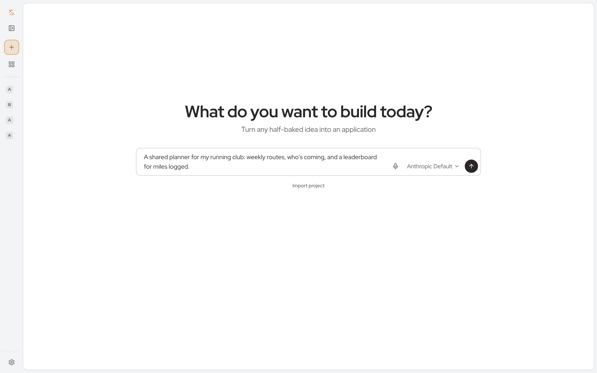
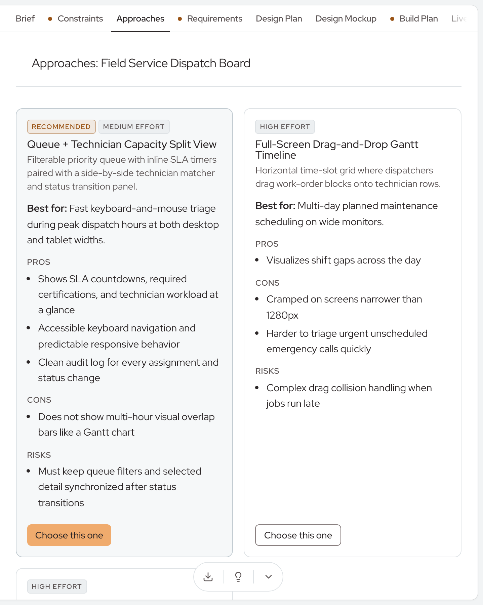
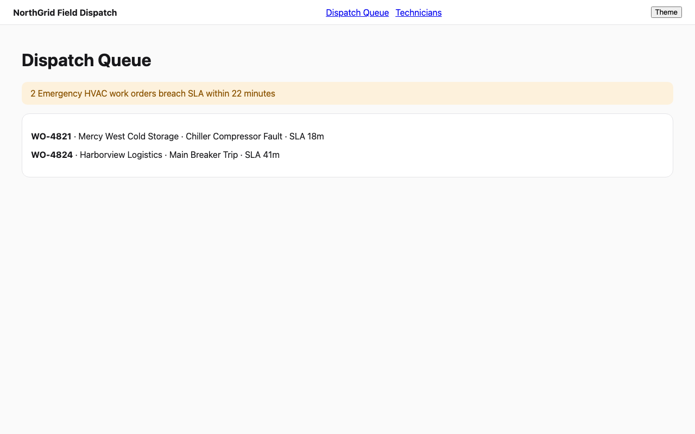
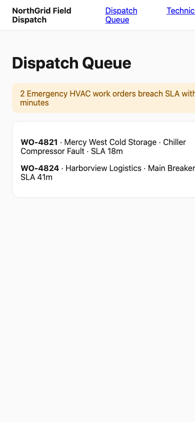
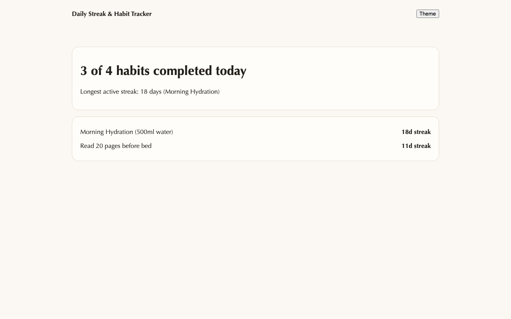

# Builder

**Prototype quickly. Build with a clear plan.**

*For vendors and service providers.*

*It starts with a sentence. Type the client's need, or say it out loud, and
Builder takes it from there.*

---

## What is Builder?

Builder is a tool that takes an idea you describe in your own words and turns
it into a real, working web application.

Move from a client brief to a working prototype, with the requirements, the
design decisions and the build plan written down along the way. No coding
required.

---

## Who it is for

Vendors and service providers who turn client needs into prototypes: for
proposals, for project scoping, and for delivery planning.

- **Agencies and consultancies** that need to show a client something they can
  click before anyone writes a line of code.
- **Solution providers** scoping a custom application, who want the
  requirements and the plan agreed before the build starts.
- **Delivery teams** that would rather hand engineering a working first
  version and five approved documents than a slide deck.

If you can describe the client's workflow to a colleague, you can use Builder.

### A client project to prototype

Prototype a client-service application where teams assign requests, track
deadlines and review AI-drafted replies. In an afternoon, Builder produces the
brief, two or three ways to build it, a clickable design for each, and a
running app the client can try.

---

## How it works

**1. Describe it.**
Describe the client's workflow, its users and its requirements. Attach notes, a
sketch or a spreadsheet; Builder reads up to 20 files per message, 10 MB each.
Builder asks the follow-up questions a product person would ask, one at a time.

**2. Shape it.**
Builder writes a short, readable brief: who the app is for, what it must do and
what "done" looks like. It writes the constraints, then lays out two or three
approaches with the pros, cons and risks of each, and recommends one. You
compare and choose.

*Builder lays out the options side by side, in plain language, with one
recommended. You read, compare and choose.*

**3. Choose a look.**
Tell Builder the style you have in mind, or let it show you several design
concepts side by side. Each concept is a clickable and editable mockup of every
screen, shown on desktop and phone, in light and dark modes. Adjust the colors,
fonts and corners until it feels right, then pick one.

*Every design is a working mockup you can click through. This one is the
dispatch queue of a field service board.*

*The same screen at phone width. Builder checks every page at 1280 px and
390 px before a design is filed.*

*Concepts differ in more than color. Builder can start three at once so the
client sees genuinely different directions.*

**4. Watch it get built.**
Builder writes a build plan and then builds the app in front of you. A live
preview runs in your browser from the first change. A checklist ticks off each
acceptance item as it is met, and the activity line says what the builder is
doing right now. Try the app as it takes shape and ask for changes along the
way.

**5. Take it with you.**
Download the source code, the design and the planning documents for client
review and the next stage of delivery. A whole project exports as one zip, with
the planning documents, the design files and the app's source in their own
folders, and imports again later.

---

## Why teams choose Builder

**Clarify the work before building.**
Define who the application serves, what it needs to do and what the prototype
should demonstrate. Review the approaches and the editable designs before
committing to the build. Nothing moves to the next step until you approve it,
and a changed document needs approval again.

**Give clients something they can try.**
Use a working prototype to gather feedback, test the proposed workflow and
refine the requirements. Make the next conversation about an application the
client can see and use, not a document they have to imagine.

**Carry the work into delivery.**
Keep the source code, the designs and the planning documents for the next
stage. Every finished app ships with a README for engineers and a user manual
for the people who will use it, with pictures of the app as built, kept current
as the app changes. Corbits audit and governance capabilities are built into
the applications, supporting enterprise requirements from the start.

**Present it to the right audience.**
Ask Builder to present the project for a CEO, a CTO, an investor, a client or
an end user, and it builds a tailored 16:9 slide deck as PowerPoint and PDF
from the approved documents, in the project's own colors and type. Share it
with reviewers, record their decisions, and pull their feedback straight into
the next revision.

**Your choice of AI.**
Builder works with the AI service you already pay for: a ChatGPT or xAI
subscription, a key from Anthropic, OpenAI, Google or xAI, or a provider of
your own. Each project runs on the model profile you pick for it.

---

## What you end up with

| Deliverable | What it is |
| --- | --- |
| Five planning documents | Brief, constraints, approaches, requirements and build plan, each approved by you at a known version |
| A design | Every screen as a clickable mockup, with the colors, fonts and corners you chose |
| A working web app | Running in the live preview and downloadable as source, with a README and a user manual |
| A slide deck, when you ask | PowerPoint and PDF for the audience you name |
| One project file | The whole project as a zip you can archive, hand over or import again |

---

## Where it runs

Builder runs on your own computer or your own server, so your clients' ideas
and data stay with you. Several people can sign in and work together in shared
workspaces, and each person connects the model provider of their choice.

Setup takes a few minutes with Docker, or you can ask your coding assistant to
install it for you.

---

## Get started

- **Project home:** github.com/corbitsdev/corbits-builder
- **User manual:** github.com/corbitsdev/corbits-builder/blob/main/docs/USER_MANUAL.md
- **Install guide:** github.com/corbitsdev/corbits-builder/blob/main/docs/SELF_HOST.md

Builder is open source, released under the GPLv2 with the AI Exception.
